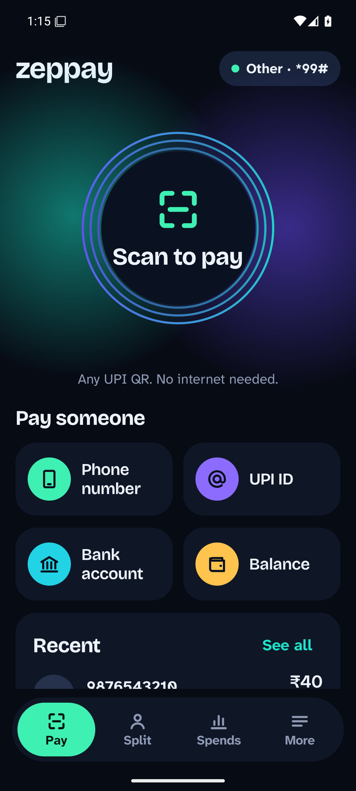
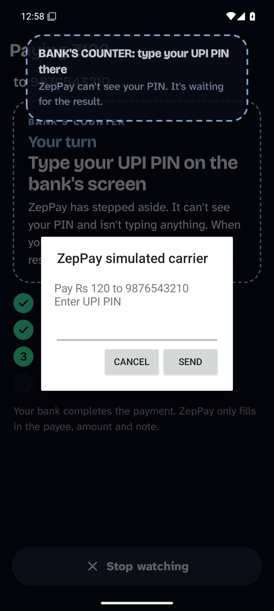
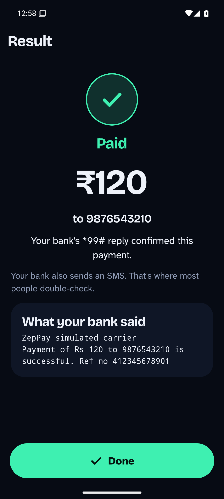

# ZepPay for Android

**UPI payments with no mobile data or Wi-Fi.** ZepPay pays any UPI QR, phone number or bank account through `*99#` (NPCI's USSD service) on your SIM, and on Jio through the **UPI 123PAY** call. Your UPI PIN is typed only on your bank's own screen. No accounts, no servers, no analytics.

> **Status:** built and tested on an Android 15 emulator against a *simulated* carrier dialog, with setup and guide clips also checked on a real Android 17 phone. Payments have **not yet been tested with a real SIM**. See [Verification status](#verification-status).

<p>




</p>
<p>


</p>

Real emulator screenshots of this build. Design contract: [docs/DESIGN.md](docs/DESIGN.md).

## What it does

- **Scan any UPI QR** (CameraX + ZXing, decoded on the phone), or pick a QR picture, or paste a UPI ID / `upi://` link
- **Pay a phone number, UPI ID, or bank account + IFSC**; pick a number from contacts (system picker, no contacts permission)
- **Stepwise `*99#` with the ZepPay helper:** dials only the menu code (e.g. `*99*1*3#`), then fills in the payee, amount and note one prompt at a time, **steps aside at the PIN prompt**, and reads the bank's reply
- **Honest outcomes:** *Paid* only when the payment flow's own reply says so after the PIN step. A bare reference number, a conflicting message, an amount mismatch or a closed screen is **Not confirmed**, shown with the bank's exact words and a "don't pay again yet" warning. Never auto-retries
- **Manual route** when the helper is off: opens the dialer with the menu code, then asks "Did it go through?"
- **Jio:** UPI 123PAY call with optional DTMF assist (phone number or bank account payees only)
- **SIM choice** for dual-SIM phones; **balance**; a read-only **"Check my SIM's menu"** that records your carrier's real `*99#` menu
- **Split a bill:** one-person splits and groups, who owes what, "Pay my share" through the normal pay flow. Stored on this phone only (no sync)
- **Spends:** monthly totals of *ZepPay-recorded* payments, clearly labelled as not a bank statement
- **First-time bank link** walkthrough, one step per screen, with a bank-code lookup
- **Setup walkthrough:** one permission per screen with what it's for, a button to the exact system screen, and automatic detection when you come back. Progress is saved; optional steps can be skipped; reopen it from Settings. The overlay card and update-install permissions are asked only when you turn the card on or install an update
- **"Watch how" guide clips:** each setup step has a short, silent clip recorded on a real Android 15 system (shipped inside the APK, no internet). It floats in picture-in-picture over Settings; where PiP is off or unsupported it plays inside ZepPay
- **Keeps going when you leave ZepPay:** a running `*99#` session lives outside ZepPay's screen, with a status notification and a Cancel button. See [Leaving ZepPay during a payment](#leaving-zeppay-during-a-payment)
- **Offline bank + IFSC finder** for paying a bank account: pick the bank, then the branch or town, and the IFSC is filled in (you can still edit it). See [Bank and IFSC list](#bank-and-ifsc-list)
- **In-app updates:** check, download, verify, install. See below

## The PIN rule

ZepPay never asks for, captures, stores, logs or relays the UPI PIN. The accessibility helper:

- listens only to phone/dialer packages, and only while a ZepPay payment is running;
- never subscribes to text-changed events and never reads editable or password fields, so whatever is typed into the bank's box is invisible to it;
- refuses to answer any prompt that mentions a PIN; it hands the screen to you instead.

This is enforced in code (`ussd/UssdService.kt`, `ussd/Flow.kt`) and unit-tested (`FlowTest`).

The stepwise approach was studied in [OffPay](https://github.com/laksh-ya/OffPayApp) (MIT). ZepPay's code is its own. Two OffPay behaviours were deliberately **not** adopted: typing the user's PIN into the dialog, and treating a reference-number pattern as success.

## Leaving ZepPay during a payment

The `*99#` session runs at app level, not inside ZepPay's screen: closing or swiping away ZepPay doesn't stop it, and the result is recorded either way. While it runs, a notification shows its progress with **Cancel** (before the PIN step) or **Stop watching** (after it; ZepPay can't promise to cancel a payment once you've typed your PIN). The notification is private: on a secure lock screen it only says "A *99# session is running", never the payee or amount, and it isn't mirrored to watches. The progress card over the bank's screen is now optional (Settings → While paying).

What ZepPay can't change: the `*99#` dialog belongs to your phone app.

- On the Android 15 emulator it is `com.android.phone/.MMIDialogActivity`, a floating dialog in its own task that is **excluded from Recents**. Pressing Home hides it, and there's no way back to it.
- ZepPay notices within about 2 seconds that the bank's screen is out of sight (rather than closed), pauses, and never types blind. If the screen comes back, it carries on. If not, after 90 seconds it ends the session: **Stopped, nothing paid** if you hadn't reached the PIN step, or **Not confirmed** if you had.
- The PIN step always needs you at the bank's screen. ZepPay never automates it or defers it.
- When the session ends while you're in another app, you get a private result notification instead of being pulled back into ZepPay.

So the honest advice in the app is: stay on the bank's screen until it's done.

ZepPay doesn't use a foreground service: while the helper is on, Android keeps ZepPay's process at high priority because it is bound to an accessibility service (measured on the emulator: `oom_score_adj` 100 while in the background).

## Bank and IFSC list

An IFSC is an 11-character code for one bank branch: 4 letters for the bank, a zero, then 6 letters or digits. ZepPay checks that format and says plainly what's wrong, but a well-formed code isn't proof that it's live.

The finder only fills in the IFSC field. It never links, checks or verifies anyone's account; linking your own account stays in your bank's `*99#` flow.

- **Data:** `app/src/main/assets/ifsc/`, built by [`tools/ifsc/build_ifsc.py`](tools/ifsc/build_ifsc.py) from a published IFSC list. Source, date, count and limits are in `meta.tsv` and shown in the app.
- **If no list is bundled:** ZepPay only checks the format.
- **Not exhaustive:** branches open, merge and close. Many co-operative banks use another bank's IFSC and appear under that bank. "Not in the list" doesn't mean wrong, and "in the list" doesn't mean live.

## In-app updates

- Release source: `update.json` on the latest GitHub Release of this repo (`mananbharti/zeppay`), next to the APK.
- Before installing, ZepPay checks the file's SHA-256, that it's the same package, a higher `versionCode`, and **signed with the same certificate**. Unverified files are deleted.
- Installs through `PackageInstaller`, asking for no-prompt install where Android allows it, and always handling Android's own confirmation (`STATUS_PENDING_USER_ACTION`). **Expect one tap plus Android's confirmation.** Silent updates are not promised.
- A background check (platform JobScheduler, twice a day, needs internet) only posts a notification. Never installs during a payment or a call.
- First time: allow "Install unknown apps" for ZepPay (asked when you first install an update, with a guide clip).

## Verification status

"Emulator" means an Android 15 emulator (Google APIs image) running a debug build against the **simulated** carrier dialog. Its window and task behaviour copies what the real phone app did there. "Phone" means a Samsung Galaxy A17 on Android 17 (One UI 9) with an Airtel SIM, over wireless adb. The phone checks used no `*99#` session.

| Area | Status |
| --- | --- |
| Flow rules (PIN handoff, outcome classifier, menu parsing), splits, spends, UPI parsing, QR decode | 52 unit tests pass |
| Setup state machine, IFSC format/search/loading, notification wording (only a bank-confirmed payment says "Paid"; lock-screen text has no payee or amount) | 21 new unit tests pass (73 in all) |
| Stepwise automation → PIN handoff → reading the reply → Paid / Not confirmed | Passed on emulator (re-checked after these changes) |
| Status notification: private visibility, redacted public version, local-only, Cancel / Stop watching | Passed on emulator (`dumpsys notification`) |
| Leaving during the session: detected in ~2 s; pre-PIN Cancel → Stopped; post-PIN Stop watching → Not confirmed; timeout while away → private result notification, no pull back | Passed on emulator |
| ZepPay's task removed from Recents mid-session: process and session continue | Passed on emulator |
| Real `*99#` dialog when leaving: hidden, not in Recents | Observed on emulator with Android's own phone app (its modem never answers `*99#`, so only the "running" dialog was seen). **Not checked on the phone yet** |
| Setup walkthrough: auto-detect on return, skip, saved progress | Passed on emulator; first two steps also on the phone |
| Android 13+ restricted settings after a file install: blocked switch → walkthrough shows the step → App info ⋮ → Allow → helper on → detected | Passed on emulator (Android 15). **Phone (Android 17) not checked yet** |
| Picture-in-picture guide over Settings | Passed on emulator and on the phone (Android 17). Inline fallback: built, not forced in a test |
| Direct link to ZepPay's own accessibility switch | **Not possible:** it needs the system-only `OPEN_ACCESSIBILITY_DETAILS_SETTINGS` permission (checked on emulator), so ZepPay opens the Accessibility list |
| Overlay permission link | Android 11+ opens the full app list, not ZepPay's page (seen on emulator); the step says so |
| IFSC finder on a real dataset (183,214 branches) | Built and loaded on the phone; search speed on low-end phones not measured |
| Real `*99#` on Airtel / Vi / BSNL, real frame texts | **Not tested.** Run "Check my SIM's menu" on a real phone and tune `ussd/Flow.kt` patterns |
| PIN handoff on a real SIM | **Not tested** |
| UPI 123PAY on Jio, DTMF timing | **Not tested** |
| Paying while on a call (USSD and 123PAY) | **Not tested.** ZepPay warns, never holds or ends a call |
| Update v1.0.3 → v2.0.0 with data kept, prompts shown | **Not tested yet** |
| 16 KB memory pages | The phone warns that two native libraries (CameraX `libimage_processing_util_jni.so`, `libandroidx.graphics.path.so`) aren't 16 KB-aligned. Fine on this phone (4 KB pages); needs dependency updates for 16 KB devices |

## Permissions

| Permission | Why |
| --- | --- |
| Phone (call) | Start `*99#` / the 123PAY call when you tap Pay |
| Phone state (optional) | See which SIMs are in the phone (carrier names) |
| Camera | Scan UPI QRs |
| Accessibility (the "ZepPay helper", optional) | Fill in `*99#` prompts; see the PIN rule |
| Display over other apps (optional) | The optional progress card above the bank's screen; never covers it. Asked only when you turn the card on |
| Notifications (optional, Android 13+) | The private payment-status notification with Cancel, and "update ready". Asked at your first stepwise payment, or in setup |
| Internet + network state | Update checks and downloads only. Payments never use the internet |
| Install packages | Install ZepPay's own verified updates |

No SMS access, no location, no contacts permission.

## Build

JDK 17 + Android SDK 35. Run from `android-app/`.

```bash
./gradlew :app:testDebugUnitTest
./gradlew :app:assembleRelease
```

Debug builds include a simulated carrier for emulator testing:

```bash
adb shell am start -n in.zeppay.zeppay.debug/in.zeppay.zeppay.MainActivity --es demo sim:ok
```

Scripts: `ok`, `ambiguous`, `fail`, `needs_account`. The simulated texts are illustrative, not captured from a carrier. The simulated dialog runs in its own task and is hidden from Recents, like the real one, so leaving the app can be tested.

Guide clips: record a step with `adb shell screenrecord`, then `tools/guides/encode.sh <raw.mp4> <step>` (`SPEED=2` for slow captures). An unrecorded step can use `tools/guides/placeholder.sh`, which makes a clip clearly labelled PLACEHOLDER. Either way, the file in `res/raw/` is replaced with no code change.

Release signing is never in the repo. Locally, put the keystore path and passwords (`ZEPPAY_KEYSTORE`, `ZEPPAY_STORE_PASSWORD`, `ZEPPAY_KEY_ALIAS`, `ZEPPAY_KEY_PASSWORD`) in `~/.gradle/gradle.properties`; CI reads the same names from GitHub Actions secrets (the keystore as base64 in `ZEPPAY_KEYSTORE_B64`). Every release must use the same key, or updates won't install over the old app.

---

<sub>UPI and *99# are NPCI's. ZepPay is an independent project, not a bank or payment service, and is not affiliated with NPCI.</sub>
