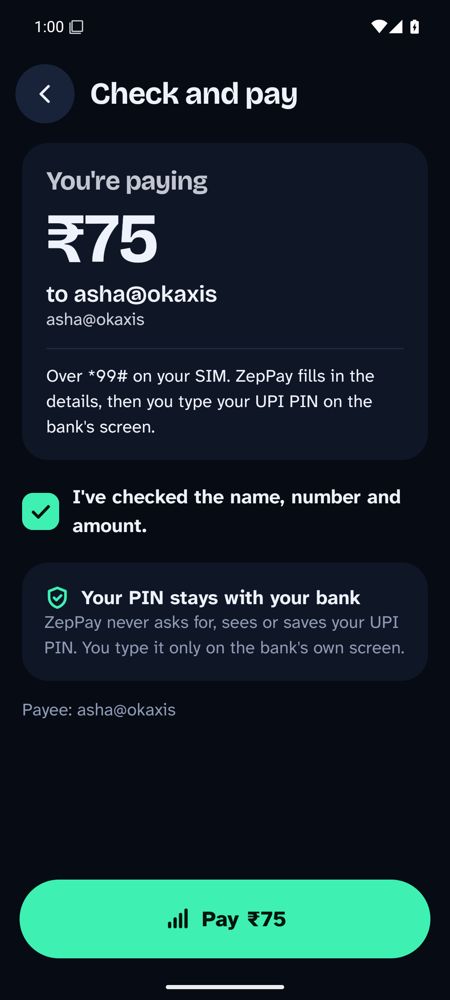
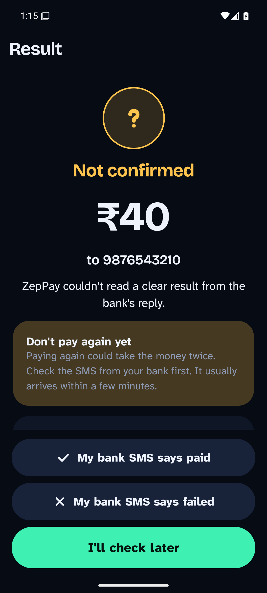
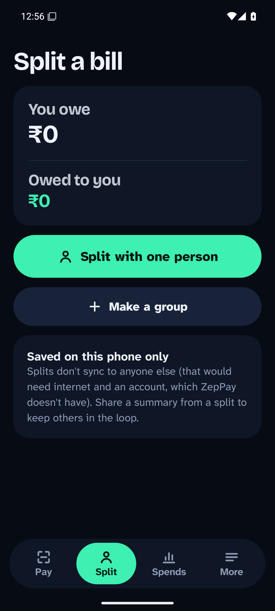
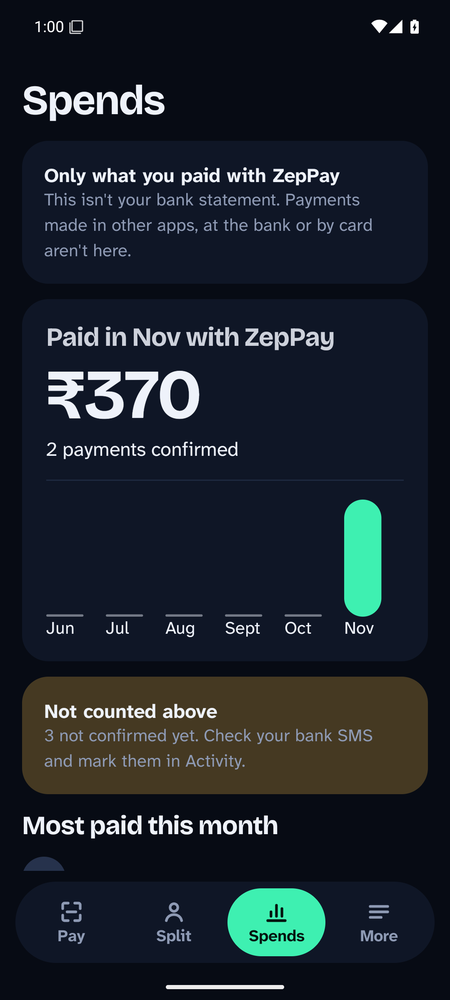
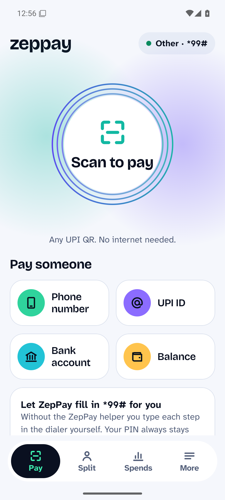

# ZepPay for Android

**UPI payments with no mobile data or Wi-Fi.** ZepPay pays any UPI QR, phone number or bank account through `*99#` (NPCI's USSD service) on your SIM, and on Jio through the **UPI 123PAY** call. Your UPI PIN is typed only on your bank's own screen. No accounts, no servers, no analytics.

> **Status:** v2.0.0 is built and tested on an Android 15 emulator against a *simulated* carrier dialog. It has **not yet been tested with a real SIM**. See [Verification status](#verification-status).

<p>




</p>
<p>




</p>

Real emulator screenshots of this build. Design contract: [docs/DESIGN.md](docs/DESIGN.md).

## What it does

- **Scan any UPI QR** (CameraX + ZXing, decoded on the phone), or pick a QR picture, or paste a UPI ID / `upi://` link
- **Pay a phone number, UPI ID, or bank account + IFSC**; pick a number from contacts (system picker, no contacts permission)
- **Stepwise `*99#` with the ZepPay helper:** dials only the menu code (e.g. `*99*1*3#`), then fills in the payee, amount and note one prompt at a time, **steps aside at the PIN prompt**, and reads the bank's reply
- **Honest outcomes:** *Paid* only when the payment flow's own reply says so after the PIN step. A bare reference number, a conflicting message, an amount mismatch or a closed screen is **Not confirmed**, shown with the bank's exact words and a "don't pay again yet" warning. Never auto-retries
- **Manual route** when the helper is off: opens the dialer with the menu code, then asks "Did it go through?"
- **Jio:** UPI 123PAY call with optional DTMF assist (phone number or bank account payees only)
- **SIM choice** for dual-SIM phones; **balance**; a read-only **"Check my SIM's menu"** that records your carrier's real `*99#` menu
- **Split a bill:** one-person splits and groups, who owes what, "Pay my share" through the normal pay flow. Stored on this phone only (no sync)
- **Spends:** monthly totals of *ZepPay-recorded* payments, clearly labelled as not a bank statement
- **First-time bank link** walkthrough, one step per screen
- **In-app updates:** check, download, verify, install. See below

## The PIN rule

ZepPay never asks for, captures, stores, logs or relays the UPI PIN. The accessibility helper:

- listens only to phone/dialer packages, and only while a ZepPay payment is running;
- never subscribes to text-changed events and never reads editable or password fields, so whatever is typed into the bank's box is invisible to it;
- refuses to answer any prompt that mentions a PIN; it hands the screen to you instead.

This is enforced in code (`ussd/UssdService.kt`, `ussd/Flow.kt`) and unit-tested (`FlowTest`).

The stepwise approach was studied in [OffPay](https://github.com/laksh-ya/OffPayApp) (MIT). ZepPay's code is its own. Two OffPay behaviours were deliberately **not** adopted: typing the user's PIN into the dialog, and treating a reference-number pattern as success.

## In-app updates

- Release source: `update.json` on the latest GitHub Release of this repo (`mananbharti/zeppay`), next to the APK.
- Before installing, ZepPay checks the file's SHA-256, that it's the same package, a higher `versionCode`, and **signed with the same certificate**. Unverified files are deleted.
- Installs through `PackageInstaller`, asking for no-prompt install where Android allows it, and always handling Android's own confirmation (`STATUS_PENDING_USER_ACTION`). **Expect one tap plus Android's confirmation.** Silent updates are not promised.
- A background check (platform JobScheduler, twice a day, needs internet) only posts a notification. Never installs during a payment or a call.
- First time: allow "Install unknown apps" for ZepPay (guided in setup).

## Verification status

| Area | Status |
| --- | --- |
| Flow rules (PIN handoff, outcome classifier, menu parsing), splits, spends, UPI parsing, QR decode | 52 unit tests pass |
| Stepwise automation → PIN handoff → reading the reply → Paid / Not confirmed | Passed on an Android 15 emulator against a **simulated** carrier dialog (debug build only) |
| Helper restarted mid-payment re-attaches | Fixed after the emulator test caught it |
| Manual dialer route + "Did it go through?" | Passed on emulator |
| Real `*99#` on Airtel / Vi / BSNL, real frame texts | **Not tested.** Run "Check my SIM's menu" on a real phone and tune `ussd/Flow.kt` patterns |
| PIN handoff on a real SIM | **Not tested** |
| UPI 123PAY on Jio, DTMF timing | **Not tested** |
| Paying while on a call (USSD and 123PAY) | **Not tested.** ZepPay warns, never holds or ends a call |
| Android 13+ "restricted settings" for the helper | Guidance built; **not checked on a real sideloaded install** |
| Update v1.0.3 → v2.0.0 with data kept, prompts shown | **Not tested yet** |

## Permissions

| Permission | Why |
| --- | --- |
| Phone (call) | Start `*99#` / the 123PAY call when you tap Pay |
| Phone state (optional) | See which SIMs are in the phone (carrier names) |
| Camera | Scan UPI QRs |
| Accessibility (the "ZepPay helper", optional) | Fill in `*99#` prompts; see the PIN rule |
| Display over other apps (optional) | Small progress sign above the bank's screen; never covers it |
| Notifications (optional) | "Update ready" and payment reminders |
| Internet + network state | Update checks and downloads only. Payments never use the internet |
| Install packages | Install ZepPay's own verified updates |

No SMS access, no location, no contacts permission.

## Build

JDK 17 + Android SDK 35. Run from `android-app/`.

```bash
./gradlew :app:testDebugUnitTest
./gradlew :app:assembleRelease
```

Debug builds include a simulated carrier for emulator testing:

```bash
adb shell am start -n in.zeppay.zeppay.debug/in.zeppay.zeppay.MainActivity --es demo sim:ok
```

Scripts: `ok`, `ambiguous`, `fail`, `needs_account`. The simulated texts are illustrative, not captured from a carrier.

Release signing is never in the repo. Locally, put the keystore path and passwords (`ZEPPAY_KEYSTORE`, `ZEPPAY_STORE_PASSWORD`, `ZEPPAY_KEY_ALIAS`, `ZEPPAY_KEY_PASSWORD`) in `~/.gradle/gradle.properties`; CI reads the same names from GitHub Actions secrets (the keystore as base64 in `ZEPPAY_KEYSTORE_B64`). Every release must use the same key, or updates won't install over the old app.

---

<sub>UPI and *99# are NPCI's. ZepPay is an independent project, not a bank or payment service, and is not affiliated with NPCI.</sub>
