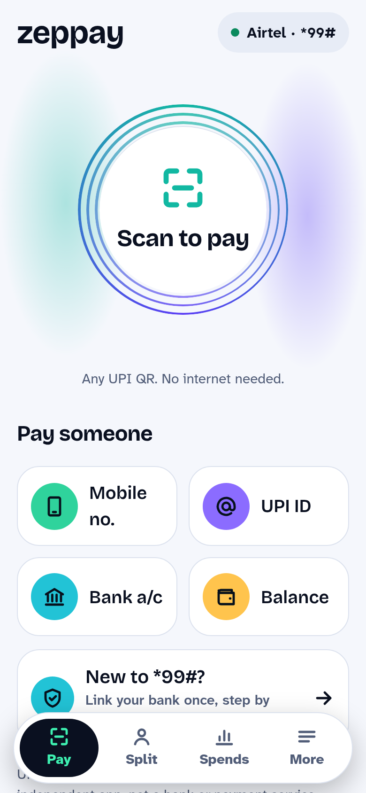
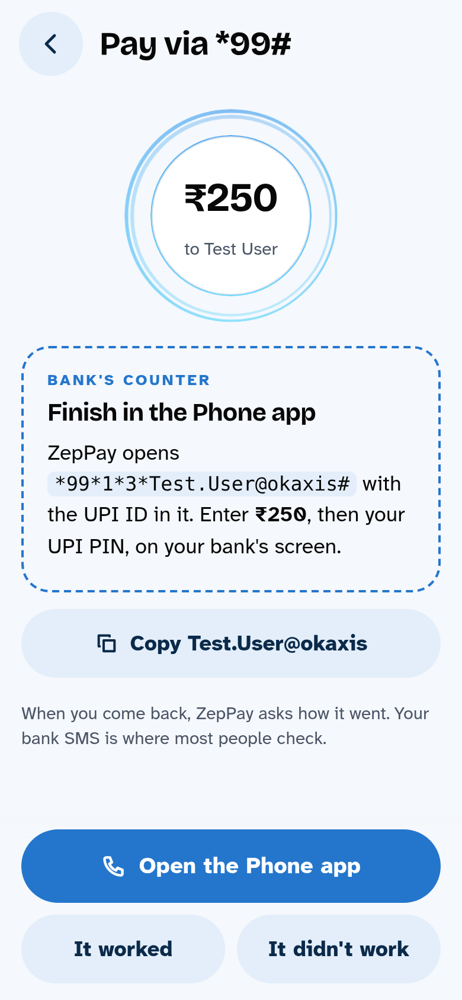
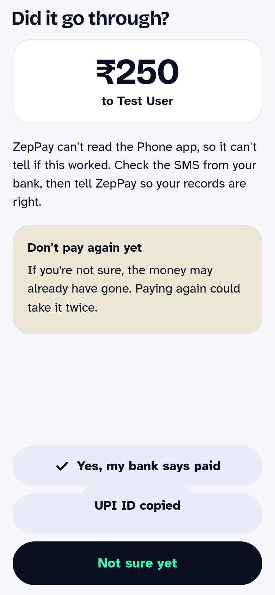
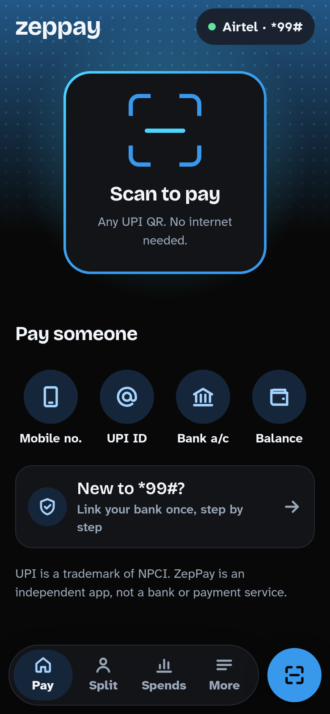
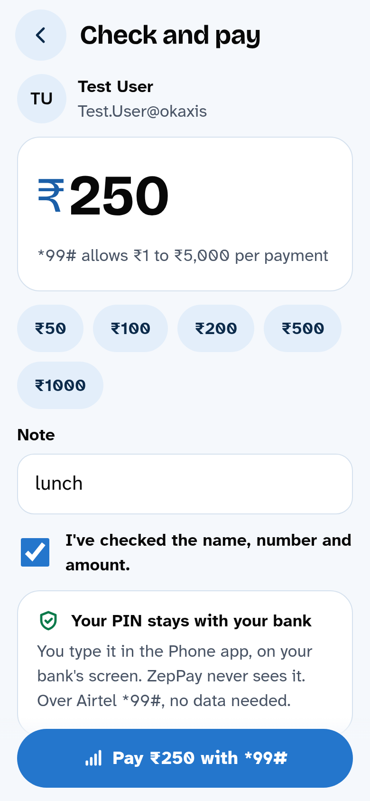
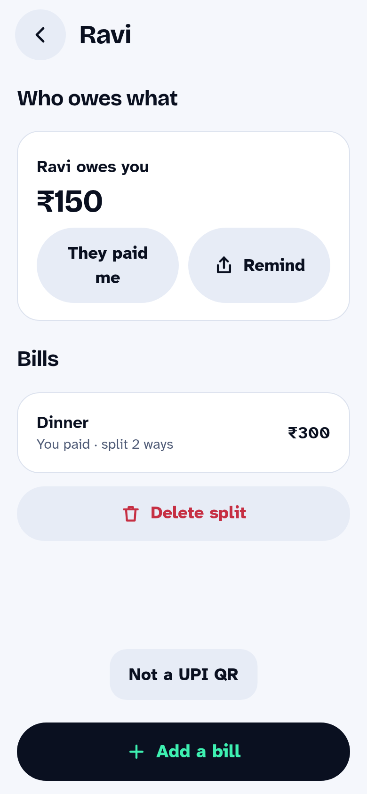
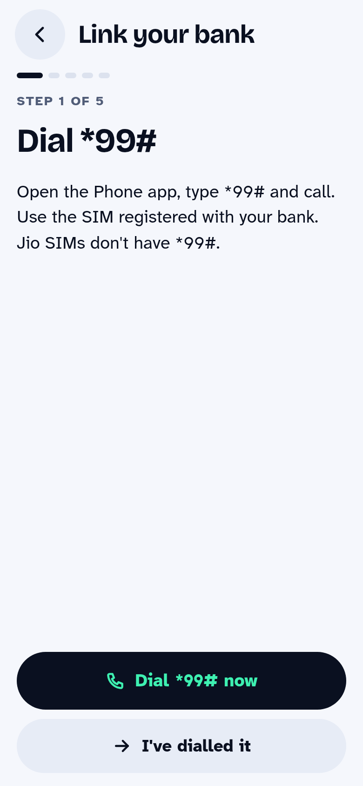
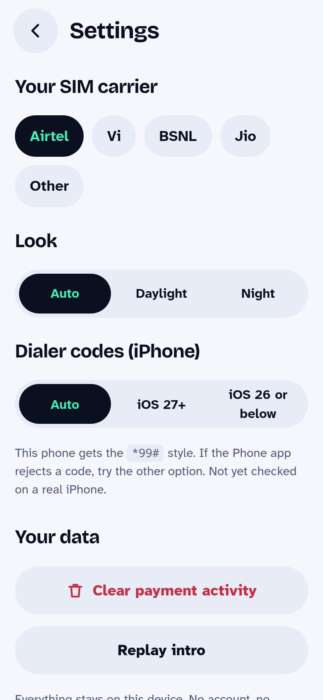

# ZepPay web app

Offline UPI payments over `*99#`, as an installable web app (PWA). It lines up the payment and hands it to your bank: the `*99#` service on your SIM (no internet needed). The payment itself is always completed by your bank.

Live (after merge to `main`): https://mananbharti.github.io/zeppay/ios/
Preview build: https://mananbharti.github.io/zeppay-pwa/

<p align="center">
  
  
  
  
</p>
<p align="center">
  
  
  
  
</p>

Design: "Blue Current", ported from the newest Android app (contract: `docs/DESIGN.md`). Screenshots are real renders from the browser test suite at 390×844.

## Features

- **Scan QR to pay**: live camera scan, pick a QR picture, or paste a UPI ID or `upi://` link (decoded on the device)
- **Pay a UPI ID, mobile number or bank account + IFSC** over `*99#` (the only payment route)
- **Copy, then open the Phone app** with the right code for the platform (see dialer codes below); the UPI PIN is typed only there
- **"Did it go through?"** when you come back. A web page can't read the bank's reply, so every status is what you marked, and the app says so. Unsure payments get a "don't pay again yet" warning
- **Balance** via `*99*3#`
- **Split a bill**: one-person splits and groups, who owes what, "Pay my share". Stored on this device only (no sync)
- **Spends**: monthly totals of ZepPay-recorded payments, labelled as not a bank statement
- **Link your bank**: first-time `*99#` walkthrough, one step per screen
- **Add to Home Screen** guide. Picture steps still need real iPhone screenshots (not faked)
- Night / Daylight / Auto, carrier picker (Jio blocks `*99#` payments), works offline once saved

## What ZepPay can and can't do

A web page can't move money or read your bank's reply. So ZepPay never claims a payment succeeded: the status in History is what you confirm. Your UPI PIN is entered in the dialer only. ZepPay never sees or stores it. Everything is kept in `localStorage` on your device. No analytics, no accounts, no servers.

## Run it

```bash
npm install
npm run dev
npm run build && npm run preview
```

## Tests

```bash
npm test                        # unit tests: UPI parsing, validation, USSD codes
npm run build && npm run e2e    # 87 browser checks in headless Chrome
```

The browser suite drives the whole app: onboarding, UPI ID and mobile entry, the exact `upi://pay` link and `tel:` codes that get opened, clipboard copy, outcome prompt on return, history, QR decode from an image, help, theme, Jio blocking, layout overflow, service worker and offline load. Set `CHROME=/path/to/chrome` if Chrome isn't at `/usr/bin/google-chrome`, `SHOTS=1` to regenerate screenshots, `TARGET_URL=...` to test a deployed copy.

## Stack

React, Vite, jsQR + zxing-wasm, hand-written service worker, bundled Bricolage Grotesque + Atkinson Hyperlegible Next (OFL). No UI kit. `node e2e/make-icons.mjs` regenerates the app icons.

UPI is a trademark of NPCI. Independent project, not a registered payment service.

## Offline installation and scanner verification

The production build generates a versioned service worker manifest covering HTML,
JavaScript (including the QR decoder), CSS, fonts, logo, icons and manifest. Wait
for "Saved for offline use" before disconnecting. Camera decoding, image upload,
payee entry, history and settings are local; no QR service is contacted.

Offline storage is not permanent: browser/OS eviction, clearing site data or a
private browsing session can remove it. Save to Home Screen where available.
Updates and reinstalling need internet. Bank payments still require a supported
SIM and cellular signal; offline does not mean without cellular service.

Dialing uses the menu, not payment shortcuts: iOS 27 uses `*99##`; iOS 26 and
older, Android and unknown versions use `*99#`. This follows the requested
compatibility rule, not a physical-device verification. Browsers that hide the
actual OS version may fall back to one hash. Choose 1 then 3 for UPI ID, 1 then 1
for mobile, or 3 for balance. The bank menu remains authoritative.

Regression commands:

```sh
npm test
npm run build
npm run e2e
OFFLINE_TEST=1 node e2e/camscan.mjs
INVERT_QR=1 OFFLINE_TEST=1 node e2e/camscan.mjs
```

Camera tests use a synthetic video feed with a test UPI payload, with the network
disabled before reloading and opening the scanner. Real iPhone camera focus,
permissions, version reporting and dialer acceptance still need device testing.
