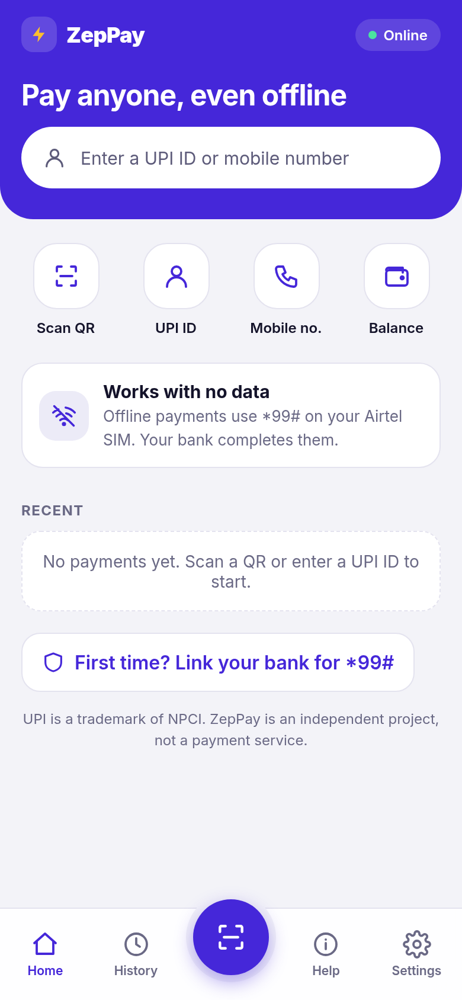
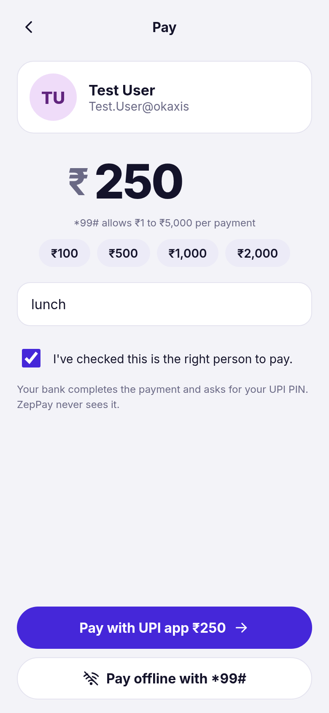
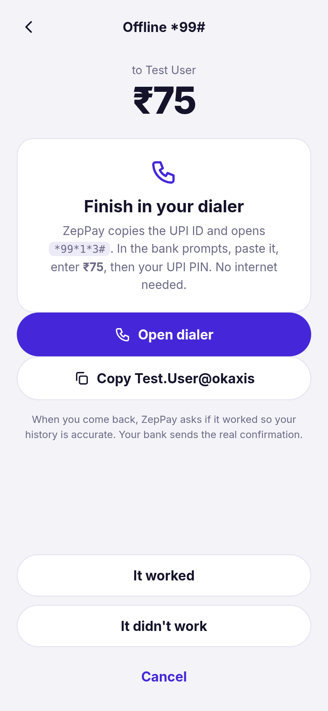
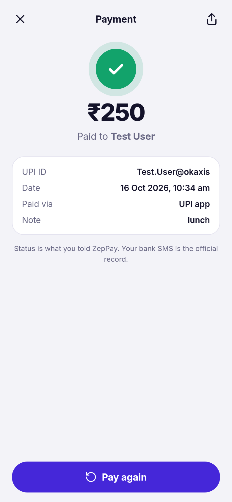
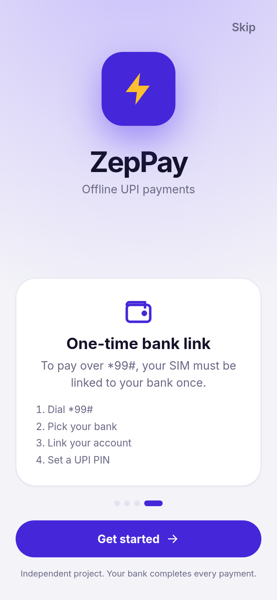
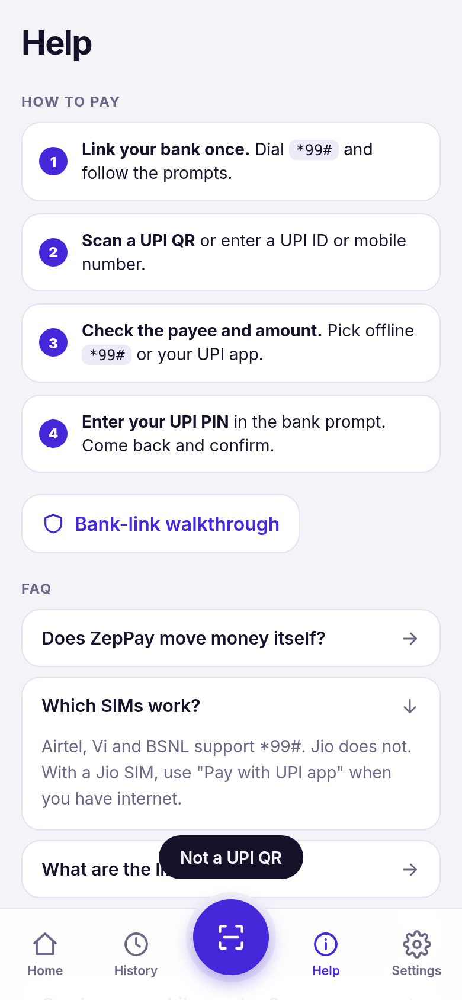
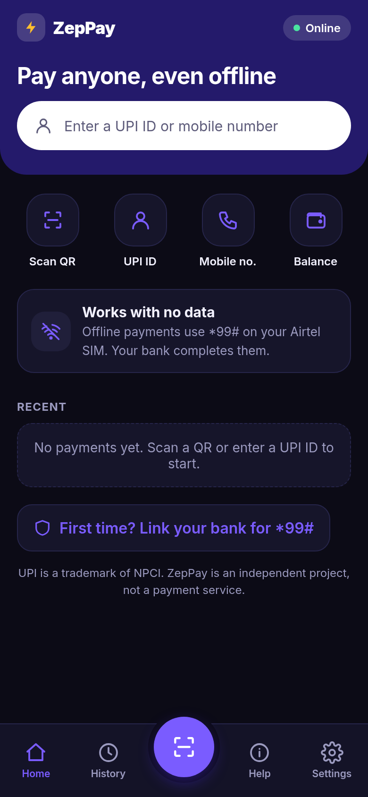

# ZepPay web app

Offline UPI payments over `*99#`, as an installable web app (PWA). It lines up the payment and hands it to your bank: either the `*99#` service on your SIM (no internet) or your UPI app (GPay, PhonePe, Paytm and so on). The payment itself is always completed by your bank.

Live (after merge to `main`): https://mananbharti.github.io/zeppay/ios/

<p align="center">
  
  
  
  
</p>
<p align="center">
  
  
  
  
</p>

## Features

- **Bank-link guide**: the one-time `*99#` setup, in onboarding, Help and Settings
- **Scan QR to pay**: live camera scan, upload a QR image, or paste a UPI ID or `upi://` link
- **Pay to a UPI ID or a mobile number**
- **Pay with your UPI app**: opens a real `upi://pay` link with payee, name, amount and note filled in. You confirm and enter your PIN in the UPI app
- **Pay offline with `*99#`**: copies the UPI ID or number, then opens your dialer with `*99*1*3#` (UPI ID) or `*99*1*1#` (mobile number). No data needed
- **Check balance**: opens `*99*3#`
- **History**: every payment you start, saved on the device. When you return from the dialer or UPI app, ZepPay asks if it went through
- **Help and FAQ**, install to home screen, Auto / Light / Dark theme, carrier picker (Jio doesn't support `*99#`, so offline payments are switched off for it)
- Works offline once loaded

## What ZepPay can and can't do

A web page can't move money or read your bank's reply. So ZepPay never claims a payment succeeded: the status in History is what you confirm. Your UPI PIN is entered in the dialer or UPI app only. ZepPay never sees or stores it. Everything is kept in `localStorage` on your device. No analytics, no accounts, no servers.

## Run it

```bash
npm install
npm run dev
npm run build && npm run preview
```

## Tests

```bash
npm test                        # unit tests: UPI parsing, validation, USSD codes
npm run build && npm run e2e    # 52 browser checks in headless Chrome
```

The browser suite drives the whole app: onboarding, UPI ID and mobile entry, the exact `upi://pay` link and `tel:` codes that get opened, clipboard copy, outcome prompt on return, history, QR decode from an image, help, theme, Jio blocking, layout overflow, service worker and offline load. Set `CHROME=/path/to/chrome` if Chrome isn't at `/usr/bin/google-chrome`, `SHOTS=1` to regenerate screenshots, `TARGET_URL=...` to test a deployed copy.

## Stack

React, Vite, jsQR, hand-written service worker, Inter. No UI kit.

UPI is a trademark of NPCI. Independent project, not a registered payment service.
